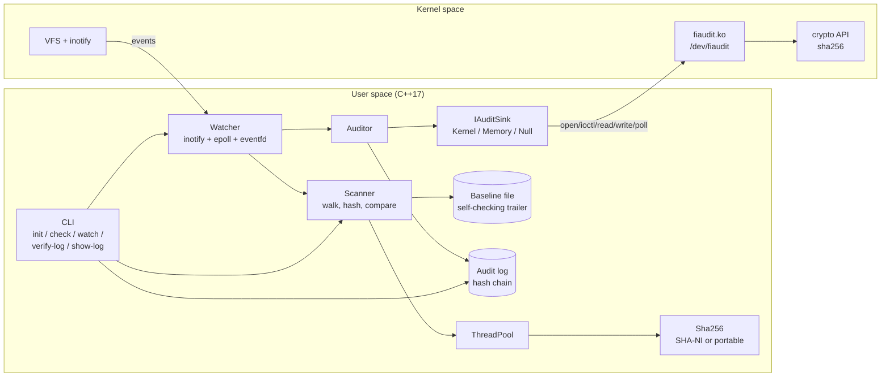
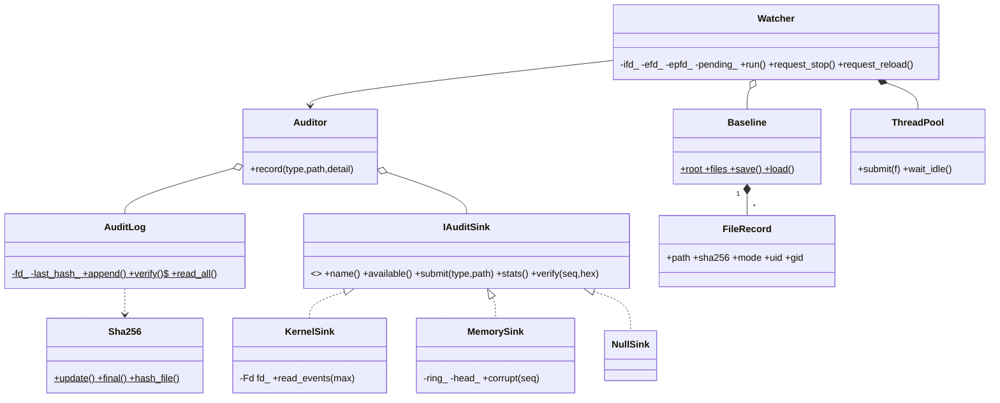
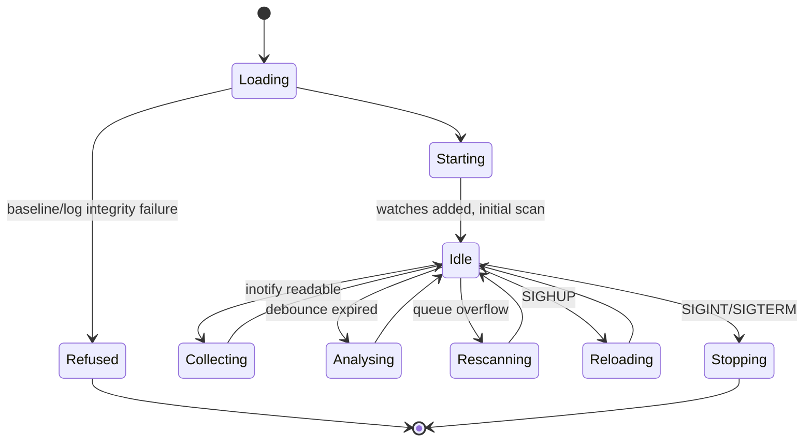

# Stage 3 – System Design & Architecture

## 1. Architecture overview



**Data flow:** the kernel reports a filesystem event → `Watcher` debounces it → a worker
hashes the file and compares it with the baseline → `Auditor` submits the event to the
kernel driver (which extends its in-kernel SHA-256 chain and returns `(seq, chain)`) and
then appends a record containing that pair to the user-space hash-chained log.

## 2. Components and responsibilities

| Component | Responsibility | Key design decisions |
|---|---|---|
| `Fd` | own a file descriptor | move-only RAII; no leaks on exceptions |
| `ExcludeSet` | path exclusion | component patterns match *relative to root* (bug found in design review: absolute paths would make `/data/x.tmp/…` self-excluded) |
| `Sha256` | hashing | streaming API; SHA-NI via CPUID dispatch; portable fallback; big-endian loads independent of host |
| `ThreadPool` | parallel hashing | condvar queue, `std::future` results propagate exceptions |
| `Baseline` | trusted snapshot | text format, percent-escaped fields, `END sha256=` trailer, atomic save |
| `Scanner` | walk + compare | `std::filesystem` without symlink-following; pure `classify()` function reused by watcher |
| `AuditLog` | hash chain | `O_APPEND` + `flock` + `fsync`; tail reload if size changed (multi-writer) |
| `Auditor` | glue | one mutex keeps kernel seq order == log order |
| `IAuditSink` | hardware abstraction | polymorphism: `KernelSink`, `MemorySink` (bit-exact model of the driver), `NullSink` |
| `Watcher` | live monitoring | single epoll thread; work in pool; atomics + eventfd for signal-safe stop/reload |
| `fiaudit.ko` | kernel anchor | ring buffer, mutex, wait queue, per-open cursor, shash SHA-256, delayed work |

## 3. Data structures

**FileRecord** (baseline row): `path, kind(f|l), size, mtime_ns, mode, uid, gid, sha256`.
`std::map<string,FileRecord>` gives ordered, deterministic output and O(log n) lookup.

**Baseline file format** (text, TAB-separated):
```
FIABASE1
R<TAB><root>            T<TAB><created_ns>      X<TAB><exclude pattern>...
F<TAB><path><TAB><size><TAB><mtime_ns><TAB><mode-octal><TAB><uid><TAB><gid><TAB><kind><TAB><sha256>
END<TAB>sha256=<SHA-256 of every byte above>
```

**Audit-log record** (one line):
```
seq  ts_ns  TYPE  path  detail  kseq  khash  prev  hash
hash = SHA256( prev "|" seq TAB ts TAB type TAB path TAB detail TAB kseq TAB khash )
```
Verification: `seq` increments by 1, `prev` equals the previous `hash`, recomputed `hash` matches.

**Kernel ABI** (`driver/fiaudit_ioctl.h`, shared by kernel and user space):
```
struct fia_event (312 bytes, no padding)
 0        8        16       20       24                        280                 312
 +--------+--------+--------+--------+-------------------------+-------------------+
 | seq    | ts_ns  | type   | pid    | path[256]               | chain[32]         |
 +--------+--------+--------+--------+-------------------------+-------------------+
chain[n] = SHA256( chain[n-1] || seq || ts_ns || type || pid || path[256] )   (host byte order)
```
`static_assert(sizeof(fia_event)==312)` guards the layout (computer-architecture topic:
alignment and ABI stability). ioctls: `GET_STATS`, `SUBMIT`, `VERIFY`, `RESET`.

## 4. UML diagrams
PlantUML sources are in `docs/uml/` (render with `plantuml docs/uml/*.puml` or paste into
plantuml.com). Mermaid versions are below so they render on GitHub.

### 4.1 Class diagram


### 4.2 Sequence diagram – live detection

```mermaid
sequenceDiagram
  actor X as Attacker
  participant K as Kernel (inotify)
  participant W as Watcher (epoll)
  participant P as Worker thread
  participant A as Auditor
  participant D as /dev/fiaudit
  participant L as AuditLog
  X->>K: modify /etc/app.conf
  K-->>W: IN_MODIFY (fd readable)
  W->>W: schedule(path, 300 ms debounce)
  W->>P: process_path(path)
  P->>P: hash file, classify vs baseline
  P->>A: record(MODIFY, path, detail)
  A->>D: ioctl(SUBMIT)
  D-->>A: seq, chain
  A->>L: append(..., kseq, khash) + fsync
```


### 4.3 State machine – watcher daemon


## 5. Design decisions worth defending
* **Why a kernel module at all?** A user-space log can be rewritten by root; kernel memory
  requires a much stronger attack (loading code / `/dev/kmem`-class access). The module is a
  small, auditable *anchor*, not a rewrite of the application.
* **Non-destructive ring + per-open cursor** instead of a consumed queue: several readers,
  and `VERIFY` can look up any retained sequence number.
* **Polling vs interrupts:** a real device would raise an interrupt; our "device" is
  software, so readers sleep on a wait queue and are woken by `wake_up_interruptible` – the
  same mechanism an interrupt handler's bottom half would use.
* **Debounce + dedupe state**: editors emit dozens of events per save; hashing after the
  burst settles saves CPU and log noise.
* **`MemorySink`**: the driver's algorithm re-implemented in user space makes every
  higher layer testable in CI without root.

## 6. Implementation plan (order of work)
1. `util`, `Sha256` (+ NIST vectors) → 2. `ThreadPool`, `Scanner`, `Baseline` → 3. CLI `init/check`
→ 4. `AuditLog` + `verify-log` → 5. `IAuditSink` + `MemorySink` → 6. `Watcher` → 7. kernel module
+ `KernelSink` → 8. hardening (sanitizers, SHA-NI) → 9. docs, packaging.

## 7. Development environment and tools
Ubuntu 22.04/24.04 (VM recommended for kernel work), `g++ ≥ 9`, `make`, `git`,
`linux-headers-$(uname -r)`, `plantuml` (optional), `valgrind`/sanitizers, `strace`,
`gdb`, `bpftrace` (optional).
```bash
sudo apt install build-essential git linux-headers-$(uname -r) plantuml strace gdb
make            # builds bin/fiaudit
make test       # 39 unit tests
make integration
make asan       # AddressSanitizer + UBSan
```

## 8. Git repository and branching strategy
`scripts/git_setup.sh` creates `main` (releases), `develop` (integration) and one branch per
stage; details, commit conventions and tags in `git_workflow.md`. Progress is tracked in
`progress_log.md`.

## 9. Roadmap to Stage 4
Implement SHA-256, scanner, baseline, `init`/`check`, and the driver skeleton; demo them.
